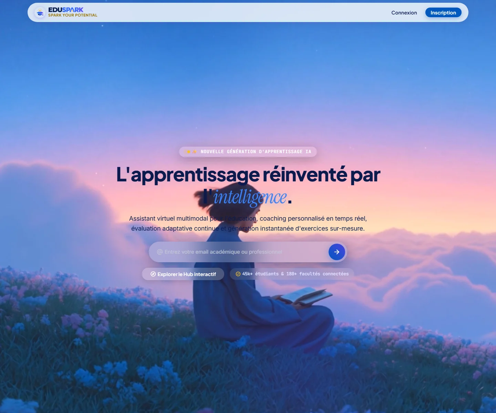
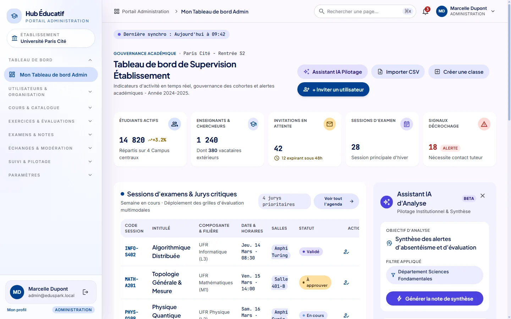
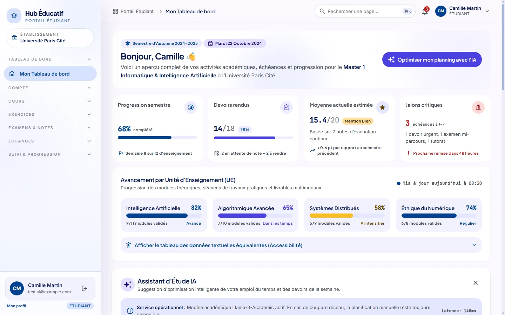
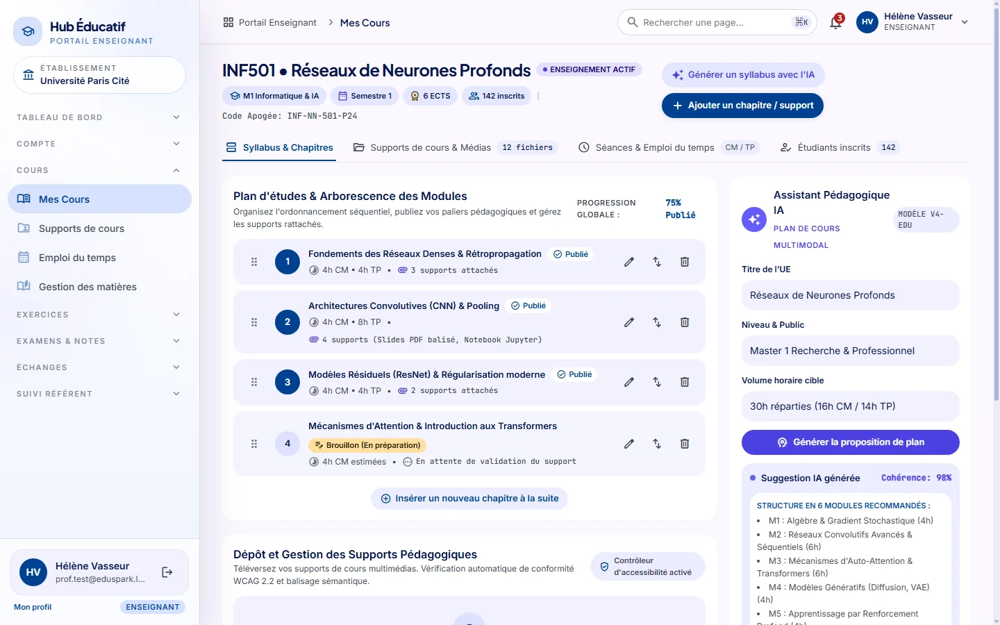

<p align="center">
  
</p>

<p align="center">
  
</p>

<p align="center">
  
  
  
  
</p>

## Overview

EduSpark is a multimodal education platform built with Django. Administrators, teachers and students each get a dedicated portal, with role-based access control, a course catalogue, exercises and assessments, exam sessions, forums, progress tracking, dropout-risk monitoring and an AI study-planning assistant.

## Highlights

- Separate admin, teacher and student portals with role-based permissions
- Course catalogue, exercises, assessments, exam sessions and grading
- Discussion forums and learner progress tracking
- Dropout-risk monitoring for teachers and administrators
- AI study-planning assistant powered by a local Ollama model
- Docker Compose stack with Django, PostgreSQL and Ollama

## Tech stack

<p align="center">
  
</p>

## Screenshots

<p align="center">
  <a href="docs/screenshots/landing.webp"></a>
  <a href="docs/screenshots/dashboard.webp"></a>
  <a href="docs/screenshots/courses.webp"></a>
  <a href="docs/screenshots/management.webp"></a>
</p>

## Getting started

**Prerequisites:** Python 3.11+ and PostgreSQL, or Docker Compose for the full stack. The AI assistant uses Ollama with qwen2.5:3b.

```bash
# Docker (recommended)
docker compose up -d
docker compose exec ollama ollama pull qwen2.5:3b

# Local Python
python -m venv .venv && source .venv/bin/activate
pip install -r requirements.txt
cp EduSpark/.env.example EduSpark/.env   # then set SECRET_KEY and DB credentials
cd EduSpark && python manage.py migrate
python manage.py seed_courses
python manage.py runserver
```

## Project structure

```text
EduSpark/       Django project (manage.py lives here)
docs/           architecture and coaching scenarios
stitch/         design assets
docker-compose.yml
```

## Documentation

- [Original project documentation](docs/README_ORIGINAL.md)

---

<p align="center">
  
</p>

<p align="center">
  Built by <a href="https://github.com/Skander-Bardaoui"><b>Skander Bardaoui</b></a> ·
  <a href="https://skander-bardaoui.netlify.app/">Portfolio</a> ·
  <a href="https://github.com/Skander-Bardaoui?tab=repositories">All repositories</a>
</p>
